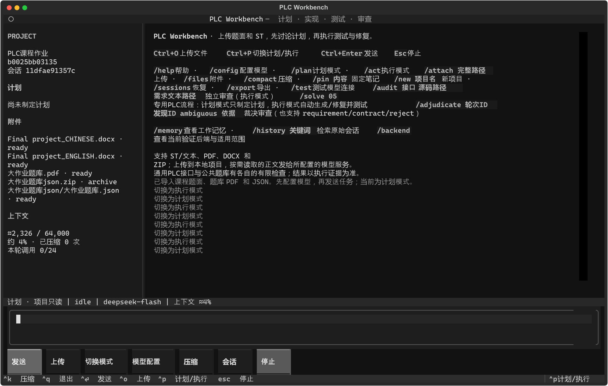

> 这是开发过程的详细使用记录；新电脑请先按根目录README.md启动。原机已配置/已导入的状态未随包携带。

# PLC Workbench

状态：本机可运行版本。最新[R4后端与修复实测](experiments/backend_r4/report.md)中，公共20题当前候选均通过明确的离线有限检查，包括原受阻4题；18题数据存取已由DeepSeek实现，使用本地PV1引用接口。这个结果是继续修复与扩展覆盖，不是独立生成的100%正确率，未验证厂商ABI。此前[R3记忆维护](experiments/memory_r3/report.md)、[R2修复记录](experiments/workflow_r2/report.md)及原始成绩均保留。它仍不是完整期末作业提交。

## 启动

双击本目录 **`launch.cmd`**。本机依赖已准备好，程序将打开已经导入课程资料的“PLC课程作业”项目。

点击 **模型配置**，填写：

| 配置 | 含义 |
|---|---|
| Base URL | 模型服务的 Chat Completions 兼容地址，通常含 `/v1`；不会自动添加 `/v1` |
| API key | 该服务的密钥；本地无鉴权服务可以留空 |
| 模型 ID | 该服务实际提供的模型名，不预设厂商或型号 |
| 工具协议 | 支持 function calling 选“原生”；否则选“JSON 指令兼容模式” |
| 流式输出 | 支持 SSE 时开启，否则关闭 |
| 上下文窗口 / 输出上限 | 按实际模型和服务限制填写；默认数值是应用预算，不是模型能力声明 |
| 独立审查模型 | 可填另一模型；留空时使用主模型的新上下文 |
| 压缩近期原文轮数 / 目标比例 / 摘要预算 | 默认2轮、50%窗口、2048输出token；预算充足时会多保留原文 |
| 仅压缩使用的扩展参数 | 覆盖主连接的同名参数；可以单独调整摘要任务的推理配置 |

发送 `/test` 测试连接。程序只发送到所填地址；不依赖 OpenAI 账号、Codex CLI、桌面应用登录或厂商 SDK。原生 Anthropic/Gemini 等不同协议未单独适配，可通过提供 Chat Completions 兼容接口的服务接入。

已使用用户授权的本机凭据验证 DeepSeek 服务，并为 TUI 配置了实际通过连接测试的地址和 `deepseek-flash` 模型。密钥只保存在本机忽略目录的 private 配置中。原始20题10题通过、R2的16题记录保留；R4补齐离线后端后，04/12/18由DeepSeek修订，08原代码通过，新后端下当前20题均通过有限检查。修复、后端能力和新增测试的收益分开列出，不作为独立模型准确率。

模型配置支持服务扩展参数 JSON。20题原批测及R2主修复使用 `{"thinking":{"type":"disabled"}}`。另做的自然语言入口试验两次未思考修复失败，开启低思考的一次通过；当前本机TUI改用 `{"thinking":{"type":"enabled"},"reasoning_effort":"low"}`，输出预算16384、请求超时120秒，保留整轮请求上限24（入口试验为10）。小样本不足以说明稳定成功。其他服务不会自动附加这些参数。服务返回的 `reasoning_content` 可按协议保留回传，不展示为用户答案。



## 常用操作

1. 点击“上传”或按 `Ctrl+O`，通过文件树选择文件，或粘贴完整路径。也可发送 `/attach "C:\路径\文件.pdf"`。
2. 默认进入**计划模式**。输入任务，agent 可以查阅附件、讨论方案、保存步骤，但不能写项目代码、编译或执行。
3. 确定方案后按 `Ctrl+P` 或发送 `/act`，切换**执行模式**，让 agent 生成代码、调用编译与测试工具、按反例修复并回归。
4. `Esc` 或“停止”中止后续步骤；当前 HTTP 请求、编译或执行可能需要等到有界操作结束。已完成的写入不会回滚，证据仍保留。
5. 点击“会话”恢复项目和会话；`/new 项目名` 新建项目，`/export` 导出当前对话为 Markdown。

公共题库可以直接发送 `/solve 05`（01–20均可）。计划模式下它只保存计划，无需API；切换 `/act` 后再次发送，程序接管生成、接口检查、版本写入和测试闭环。可加源码路径，例如 `/solve 05 code/seam.st`；首次默认 `candidate.st`，继续同题会继承已计划的路径和修订上限，也可显式覆盖。自然语言如“实现第05题并测试”也能调用同一工具。已有候选先测试，明确后端缺失时停止并保留证据；后端能力以当前实际选择为准，旧发布版的限制不会误套到R4。

普通项目列表默认隐藏批测项目；CLI `projects --include-benchmarks` 可查看全部。上传、计划和压缩等通用功能仍可用于自建题库；专用自动行为判据目前只适用于已接入的接口。

`Ctrl+Enter` 或点击“发送”发送消息，普通回车可在输入框换行。窄于 100 列的终端会隐藏侧栏；推荐 120×35 以上。多行输入、中文文件名和含空格路径均支持。

支持 `.st`、文本、Markdown、JSON、CSV、YAML、PDF、DOCX 和 ZIP。上传指**复制到本地项目**，不会把整个文件原件发送到远程。附件清单与工具按需读取的正文会进入所配置模型的请求。PDF/DOCX 提取文本；扫描 PDF 标记待 OCR，不自动识图。ZIP 保留原包并导入支持的成员；单文件及 ZIP 解压总量上限 32 MiB，最多 1000 项。

可直接尝试：

```text
先查看附件中的作业要求，说明我们负责的agent设计需要交付什么。
先不要写代码，保存一个实现和验证计划，列出目前缺少的信息。
```

## 上下文压缩

`/compact`、`Ctrl+K` 或“压缩”触发手动压缩。接近配置窗口的75%，或需要为输出预留空间时自动触发。工作记忆由模型总结，包含目标、用户约束及更正、决策、失败尝试、待办、需求歧义和证据；既有记忆会传给后续摘要，不会只留下最后一个片段。

近期原文按预算保留：默认以2轮为近期保留要求，空间足够会多保留，可在设置中调整；压缩目标默认约为窗口50%。摘要有独立输出预算，长历史分批请求，每次预留输入和输出空间。一次很长的工具循环也可总结已完成事务，不拆散调用和结果；必要时减少近期保留范围，最新用户原文仍保留，界面显示实际轮数。

固定笔记、当前计划和源码验证记录由程序单独注入，不经过摘要。完整SHA及原始陈述来源也另外保留，避免模型用省略形式代替版本身份。`/pin 停止必须优先于启动` 添加笔记，`/pins`列出，`/unpin 1`删除第一项。引用的原陈述不代表文件状态已验证。

`/memory` 查看工作记忆；`/history 关键词` 检索原始会话，模型也可用只读 `read_history` 分页找回原话及执行证据。原历史在会话 `compactions/` 留档；开始网络请求前即保存 `compaction_jobs/`，分段中断后能继续。取消、格式错误、摘要过大或未节省空间时不替换原上下文。最新用户原文自身超窗时明确报错，不默默截断。

压缩服务参数独立配置，核心不预设厂商。本机DeepSeek主任务保持低思考，压缩参数使用 `{"thinking":{"type":"disabled"}}`。真实试验发现思考模式曾用完2048输出预算而未返回完整摘要；另一次虽有摘要，却未准确回取SHA；修订后的一次11项追问全部通过。三次记录都保留，不能据一个样本声称普遍可靠。上下文用量仍是字节估算，显示 `≈`，服务返回的token计数另行显示。

## PLC 闭环与对抗审查

agent 可读写项目文件、搜索资料、保存计划、编译、运行扫描轨迹、精简和重放反例、比较版本。工具执行记录和完整结果留在项目中。

`plc_compile_unit` 支持一般 ST 单元的离线编译，包含实际 ST→C++→目标文件编译。通用 `plc_probe` 有 `motor`、`blower`、`edges`、`moving_average`、`ipv4` 五种接口；`plc_bank_test` 另接入公共题库固定判据。07/17使用显式copy-in/copy-out；R4的08直接绑定开放数组，18通过本地PV1传输实际元素。未知接口可以做编译检查、提出测试规约，不能声称已通过行为验证。

专用流程每题默认最多3次源码修订；格式错误提案不覆盖文件、不占源码修订次数，但仍占模型请求，最多另有2次提案余量。通用对话、压缩和内部修复共享配置中的逻辑调用总上限；429/502/503/504错误会在一次调用内最多尝试3次HTTP请求。验证结论绑定源码SHA、后端和判据指纹，任一变化后旧记录不能继续当作当前通过结论。网络错误、版本冲突和预算耗尽均保留记录；模型自称成功不能覆盖实际失败。最新记录位于项目 `workspace/workflow_runs/`。

已有文件修改要求提供最近读取的 SHA256；每次写入保存旧版本及 diff；上传原件不可覆盖。计划模式由工具执行层强制限制，模型无法自行解除。程序不提供任意 shell 工具。工具路径边界也不是用于运行恶意原生代码的操作系统沙箱。

独立审查命令示例（路径相对项目 workspace）：

```text
/audit motor code/motor.st requirements.md
```

审查请求只带需求、接口和候选源码，没有作者对话与已有测试结果；不执行审查模型返回的代码。提案通过结构、输入域和源码哈希检查后，两次独立执行复核。初始结果为待裁决，不能由模型给自己的假设盖章。

用户可据原始题面裁决并重放，例如：

```text
/adjudicate 轮次ID ADV-001 requirement 题面明确规定停止优先于启动
/adjudicate 轮次ID ADV-002 ambiguous 原题未规定复位与采样同时发生时的优先级
```

还支持 `contract`（仅按已声明测试契约）和 `reject`（驳回）。即使用户接受，若冻结监视器不支持该断言，仍返回判据冲突，不会自动确认缺陷。完整裁决规则见 [审查说明](docs/ADVERSARIAL_REVIEW.md)。

**离线后端不是 CODESYS；未执行形式化求解器或实体 PLC。** 当前agent尚未实现物理对象模型、两框架×两模型完整比较或完整作业报告。独立审查是单独触发的流程，不会在每次 `/solve` 通过后自动运行。

## 验证后端

本机已选中独立构建的PLC-R4扩展，`/backend`查看当前后端。它增加LTIME、一维开放数组及本地PV1泛型引用原语。TIME_TO_LINT的单位是毫秒，LTIME_TO_LINT是纳秒；时间内部采用64位纳秒，不等同于所有厂商的32位TIME。第18题的PV函数只复制单个元素，FIFO算法写在ST内。

R4有源码提交、完整补丁、构建清单和许可证，原0.7.0后端仍保留。更换编译器或运行库自动隔离构建缓存。详见[后端重建与边界](backend_extensions/README.md)。

```powershell
python -B -m plc_agent.backend_r4 status
# 切回保留的旧后端；其4题限制仍会如实报告
python -B -m plc_agent.backend_r4 legacy
# 重新选中已构建R4
python -B -m plc_agent.backend_r4 activate
```

## 配置与本地数据

默认保存于本目录 `agent_data/`，可通过 `PLC_AGENT_HOME` 改变位置：

```text
agent_data/
  config.json                  连接参数，无密钥
  private/credentials.json     用户在界面填写时的本机密钥文件
  projects/<项目ID>/
    project.json               附件清单与项目元数据
    workspace/                 上传快照、候选代码、执行证据与审查
    versions/                  修改前后内容与哈希
    sessions/<会话ID>/
      session.json             模式、计划、固定笔记、用量
      context.json             当前模型上下文
      events.jsonl             持续保存的对话与工具记录
      compactions/             被压缩的原历史与摘要
      compaction_jobs/         未完成的分段摘要及可续接进度
      transcript.md            导出结果
```

界面填写的密钥保存在本机文件，不宣称加密。也可只使用环境变量 `PLC_AGENT_API_KEY`，这类密钥不会复制进配置文件。可设置自定义密钥环境变量名。凭据不注入模型消息，不进入会话或导出；报错会脱敏。更换服务地址不会沿用此前地址保存的密钥。`agent_data/` 已加入 `.gitignore`，分享代码时不要附带它。

PowerShell 环境变量配置：

```powershell
$env:PLC_AGENT_BASE_URL = 'https://你的兼容服务地址/v1'
$env:PLC_AGENT_MODEL = '服务提供的模型ID'
$env:PLC_AGENT_API_KEY = '在本机填写'
```

`.env.example` 仅作模板，程序不会自动读取 `.env`。请求地址为 Base URL 加 `/chat/completions`，若已填写完整该端点则直接使用。

## 开发与验证

Python 3.10+。Windows 初次运行可使用 `scripts/setup.ps1`：从官方 PyPI 文件源下载固定 wheel、验证 SHA256，再离线安装到工作区 `_cache/plc-agent/venv/`。本机已完成；不修改全局 Python 或 PATH。

```powershell
# 在本目录、使用准备好的 Python 环境
python -B -m plc_agent doctor
python -B -m plc_agent ui
python -B -m plc_agent projects
python -B -m plc_agent compact
python -B -m plc_agent memory
python -B -m plc_agent history '停止优先' --max-events 8
python -B -m plc_agent solve 05 --mode plan
python -B -m plc_agent solve 05 --mode execute --max-revisions 3
python -B -m plc_agent run --new '实验' --mode plan --attach '题目.md' '读取题目并制定计划'
python -B -m unittest discover -s tests -v
```

ST 工具链另见 [原工具说明](README.md)。编译器临时文件现保存在构建缓存内，避免依赖系统临时目录权限。

本地验证包括：HTTP/SSE 分片、Bearer 鉴权、原生工具与 JSON 模式、HTTP 重试/错误脱敏、截断响应拒绝执行、计划模式拦截、中文/ZIP/PDF/DOCX 上传、版本冲突、手动/自动压缩、会话恢复、取消、独立审查隔离与需求裁决、真实 ST 失败→修复→回归，以及终端按钮与缩放。

初版62项、原20题轮次69项、R2的88项、R3的117项记录均保留。R4完整回归运行126项，125项通过、1项旧后端专属用例跳过；另有显式旧后端预检验证及上游93项选定测试。详见[R4日志](experiments/backend_r4/regression_tests.log)与[结构化核验](experiments/backend_r4/final_validation.json)。20题各重放两次，每轮20789次调用；另换种子检查3261个扫描点，各重放两次。原固定判据未改，引用与时间补充判据单独留档。模拟服务自检不计为真实模型表现。

接口与界面开发参考：[函数工具调用协议](https://developers.openai.com/api/docs/guides/function-calling)、[Textual 测试](https://textual.textualize.io/guide/testing/)、[Textual 后台任务](https://textual.textualize.io/guide/workers/)。模型服务地址完全由用户选择。
