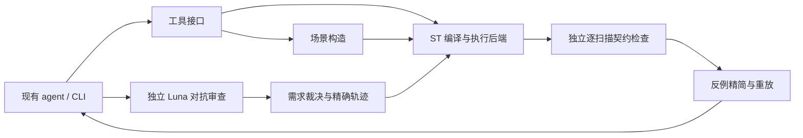

# PLC Probe：让 agent 得到可复现的行为反馈

**新增：[PLC Workbench 终端 agent](AGENT_README.md)**。启动 `launch.cmd`，自行配置 `base_url` / `api_key` / `model`。提供文件上传、计划/执行模式、会话恢复、上下文压缩及 PLC 工具闭环；原工具与历史实验记录保留在下文。

**最新实测：[R4后端扩展与剩余题修复](experiments/backend_r4/report.md)**：新增LTIME、一维开放数组和本地PV1泛型引用接口；04/12/18由DeepSeek修复、08原代码通过，当前20题均通过有限离线检查，原16题没有回退。它是继续修复及扩展覆盖，不是独立生成的100%准确率，未验证厂商ABI。另见[R3记忆维护](experiments/memory_r3/report.md)。

**最新实测：[PLC专用流程R2报告](experiments/workflow_r2/report.md)**。从原20题最终候选继续修复，16题通过有限检查：4题由DeepSeek修复，2题新增结构体行为覆盖，原10题保持通过；剩4题受LTIME/开放数组/VARIANT后端支持阻塞。原始[20题报告](experiments/deepseek_20/report.md)及[可筛选结果页](experiments/deepseek_20/report.html)保留，不能把R2当作独立生成准确率。

终端已加入 `/solve 05` 的程序控制修复流程，包含接口检查、源码版本、同版本反馈、失败约束记忆、全流程请求上限与SHA绑定结论。详见[架构说明](docs/AGENT_ARCHITECTURE.md)。

状态：**原型完成，待审核**。这是工具可行性实验，不是完整期末作业提交。

用户希望先实际构建、测试，再判断 PLC 工具应解决什么问题。本原型检查有状态 ST 程序在停止、恢复、重复信号和数据边界下的行为。现有大模型或 agent 可以通过 MCP 调用它，不需要为这轮实验配置模型密钥。

## 当前能做什么

- 用已有开源编译器编译**实际 ST 源码**，执行其产生的原生程序。
- 构造带时间戳的扫描输入，使用独立手写契约检查执行后输出。
- 精简失败序列，保存后在新进程中重放，作为修复及回归证据。
- 对两个版本使用同一套契约，报告新增失败和修复的失败。
- 提供七个 MCP 工具，默认只返回摘要和失败证据，完整数据留在本地。
- 由另一独立 Luna 对题面和候选源码做对抗审查，再通过需求裁决和两次新进程执行复核。

**本机当前选择STruC++源码构建的PLC-R4扩展＋g++，未运行CODESYS或形式化求解器。** 20题现在均有明确范围的有限行为检查；没有实体PLC、完整机器模型或完整LLM对比实验。有限轨迹通过不表示已证明正确。下文保留最初工具实验的范围及记录；原0.7.0发布后端可单独恢复，最新扩展见上方说明。

## 先看结果

- **[GPT-6 Luna 独立生成与反馈修订](experiments/luna/README.md)**：5 题，保留首稿及两次兼容性修订；主代理只做工具和评估，没有替它改 ST。
- [对抗审查流程与裁决约定](docs/ADVERSARIAL_REVIEW.md)
- **[独立 Luna 对抗审查实测](experiments/adversarial_review/README.md)**：五题审查，1 项需求歧义，两次重放；0 项已确认缺陷。
- [第一轮实验记录](reports/latest/report.md)
- [可筛选的 HTML 报告](reports/latest/report.html)
- [逐场景原始结果](reports/latest/results.json)
- [匹配扫描调用预算的后续实验](reports/latest/budget_study.json)
- [逐扫描反例](reports/latest/counterexamples/blower__timer_not_reset.json)

样本包括 3 个小契约、每个契约 2 个不同风格的正确对照，以及 12 个人工植入故障。它们不是工业现场故障样本，也不是模型生成的答案。

## 运行

依赖 Python 3.10+、g++（C++17）以及一个固定版本的便携 ST 编译器。Python 端只有标准库，无需 pip 安装。

在本目录打开终端：

```powershell
python -B -m plc_probe doctor
python -B -m plc_probe bootstrap
python -B -m plc_probe demo
python -B -m plc_probe.budget_study
python -B -m plc_probe.model_evaluation repair_2
python -B -m unittest discover -s tests -v
```

`bootstrap` 仅下载并校验编译器，存入工作区 `_cache/plc-probe/`，不修改 PATH 或安装全局软件。下载源固定为官方 GitHub release，SHA256 写在 `plc_probe/config.py`。本机已完成这一步。重新下载工具链需要网络；之后运行不需要网络。

自动引导目前支持 Windows x64；其他环境可自行准备编译器，并设置 `STRUC_PP_HOME`。可用 `CXX` 指定 g++，用 `PLC_PROBE_CACHE` 改变构建缓存位置。

## 单独检查和复现

```powershell
python -B -m plc_probe probe examples/blower/mutants/timer_not_reset.st --profile blower --suite focused --output reports/probe.json
python -B -m plc_probe replay examples/blower/mutants/timer_not_reset.st reports/latest/counterexamples/blower__timer_not_reset.json
python -B -m plc_probe replay examples/blower/correct.st reports/latest/counterexamples/blower__timer_not_reset.json
python -B -m plc_probe compare examples/blower/correct.st examples/blower/mutants/timer_not_reset.st --profile blower
```

第二条应复现故障，第三条检查同一输入下正确实现是否消除了故障。`probe` 发现程序行为失败时退出码为 1；工具调用本身的错误（如编译失败、超时）在 JSON 中单独分类。

固定接口：`motor`（作业文档示例）、`blower`（公共题 06）、`edges`（公共题 02）、`moving_average`（公共题 09）、`ipv4`（公共题 14）。人工故障自检实验只覆盖前三个；Luna 实验覆盖全部五个。不支持的接口不能被当作测试通过。

## agent 接入

任意支持 MCP stdio 的本地客户端可启动：

```text
命令：python
参数：-B <本项目的绝对路径>/agent_tools.py
```

服务提供：`plc_environment`、`plc_compile`、`plc_probe`、`plc_run_trace`、`plc_replay`、`plc_compare`、`plc_adversarial_review`。参数 schema 可通过 `tools/list` 获得。服务不监听网络端口；本轮没有修改任何现有 agent 的全局配置。

工具结果是供模型使用的**观测证据**。`plc_probe` 返回 `status=fail` 表示发现被测程序缺陷；MCP 的 `isError` 仍为 FALSE。编译器缺失、格式错误、超时等才是工具错误。

## 结构与边界



- `backend.py`：调用已有编译器，生成扫描驱动；没有自行实现 ST 解释器。
- `contracts.py`：独立判定预期行为；并非从候选程序复制逻辑得到“答案”。
- `scenarios.py`：正常流程、针对性边界及固定种子随机场景。
- `tools.py`：检查、精简、重放及版本回归比较。
- `adversarial.py`：执行独立审查假设、检查源码身份、保留两次重放和裁决证据。
- `server.py`：MCP stdio 工具；验证摘要与完整数据分开存放。
- `examples/`：可审查的正确实现与明确标注的人工故障。

详细约定：[契约与 LTL 表达](docs/CONTRACTS.md)、[来源及依赖](docs/SOURCES.md)。

后续优先事项：接入本机可用的 CODESYS 执行后端，对同一轨迹交叉重放；再收集未经当前故障目录指导编写的实现和真实案例。对接前，不能把离线后端结果填入作业的 CODESYS 编译通过率。
