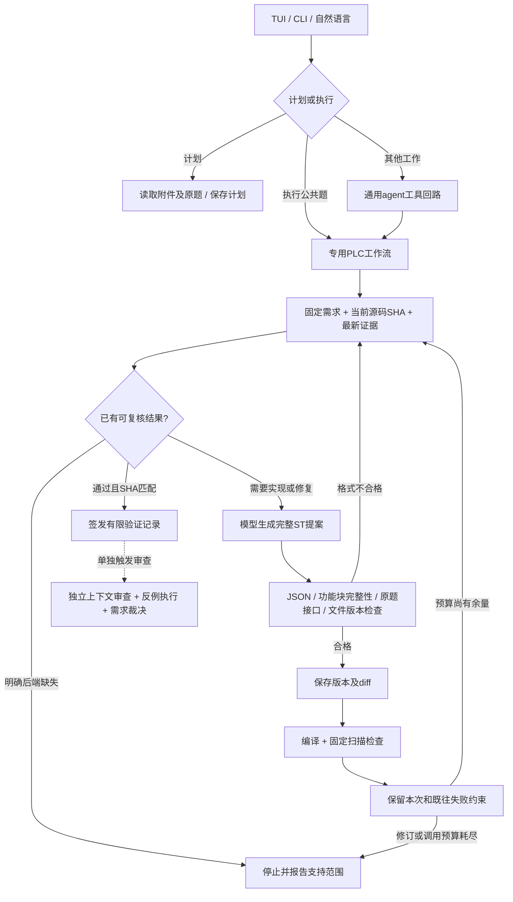

# PLC Workbench agent 架构

本地R5扩展已将CODESYS编译加入完成条件，并增加保留字检查、平台预检、有效编译缓存和无进展终止。使用 `agent_data/validation.json` 独立于模型连接配置。详见 [R5实现与本地验证](AGENT_OPTIMIZATION_R5.md)；下文保留原R4架构与历史实验范围。

这是一套本地、模型服务可替换的PLC编程agent。通用对话负责资料、讨论和计划；PLC专用工作流负责可靠地推进源码修订与验证。两者共享文件边界、会话、取消和模型调用预算。

## 各层职责

| 组件 | 职责 |
|---|---|
| `tui.py`、`__main__.py` | 文件上传、计划/执行模式、会话选择、压缩、`/solve`与CLI入口 |
| `provider.py`、`config.py` | 用户配置base URL / API key / model；SSE、原生工具、JSON兼容、服务扩展参数；不预设厂商 |
| `engine.py`、`context_memory.py`、`call_budget.py` | 通用agent、任务范围收敛、持久上下文、可续接的分段摘要、精确引用；外层与专用流程共用请求上限 |
| `workflow.py` | 程序控制的生成→接口检查→版本写入→测试→修复；模型不必自己选择每个推进步骤 |
| `toolbox.py`、`storage.py` | 工具校验、项目路径约束、SHA冲突、原件保护、历史版本、项目锁和会话记录 |
| `bank_runner.py`、`plc_probe/` | 保留原20题的固定有限判据，使用实际ST→C++→原生程序执行 |
| `extended_eval.py`、`struct_checks.py` | 单独增加07/17固定结构体数组覆盖，显式说明复制传输的语义边界 |
| `reference_checks.py`、`duration_checks.py` | R4新增实际调用方引用、FIFO元素存取、长时累计与重触发保持检查，原判据保留 |
| `backend_r4.py`、`backend_extensions/` | 固定源码构建及补丁、后端选择、产物校验、独立缓存、本地PV1引用原语 |
| `backend_capabilities.py` | 按实际后端指纹执行已知能力预检；明确区分后端阻塞与候选实现缺失 |
| `review.py`、`adversarial.py` | 独立审查提案、输入及哈希检查、两次重放与需求裁决，模型意见不直接当真值 |

## 为什么不只加长提示词

初次真实20题实验中，模型会反复列目录、读取旧日志、探测不相关接口，少数题耗尽步骤也未修改源码。专用工作流直接把当前需求、源码和同版本的失败证据送给模型；代码返回后由程序自动运行编译和测试，循环只保留必要信息。

修复失败时，后续请求包含最新反例和已见失败约束，避免模型修好一个问题又重新引入旧问题。上下文不累计整个目录的旧日志。通用对话仍可用，明确请求某道公共题时收窄工具范围，避免选择无关的PLC接口。

## 结论由执行记录决定

- 模型输出的“已完成”不能覆盖失败记录。只有当前文件SHA、后端和判据指纹均匹配通过记录，才报告已通过当前有限检查。
- JSON或接口检查失败时不覆盖原文件。格式重试不计为源码修订，但仍计入总模型请求数，且有独立上限。
- 文件在模型生成期间被外部修改时停止，保留用户版本。
- 网络失败、预算耗尽、后端缺失均保留文件和证据，不伪装成功。达到预算时可直接用已有验证记录给结论，不为写总结额外花一个模型请求。
- 计划模式不写候选、不编译、不执行；`/solve`的固定计划不要求API已配置。
- 批测项目与正常项目分开标记，启动程序不会自动进入最后一个批测失败项目。

## 上下文与模型服务

通用对话按需手动/自动压缩历史。模型负责工作记忆，近期原文数量按目标预算选择，默认近期要求2轮且可配置；单轮工具输出过大时按完整事务总结，保留最新用户原文。每次摘要请求都有独立输出预留和大小检查，分段结果可续接，失败或取消不替换原上下文。原始记录可用只读read_history检索。

固定笔记、当前计划、精确SHA及原始引用、最近一次PLC验证记录独立保留。模型摘要不负责重写版本身份。摘要模式的服务扩展参数可以单独覆盖主任务参数，避免主任务的推理配置耗尽小摘要预算。摘要不是完整性证明，必要时应检索原话。

专用流程每次使用新的紧凑输入包，不继承杂乱对话。代码作者和独立审查者使用隔离上下文。任何服务特有的thinking参数只从配置传入；目前按用户选择测试了DeepSeek，但核心不依赖其SDK或账户登录。

## 当前验证边界

R2从原20题的最终候选继续修复，16题通过有限检查；R3确认18旧候选只维护计数。R4扩展独立后端后，04/12/18由DeepSeek修复，08原代码通过，现在20题当前候选均通过本轮有限检查。原始成绩未覆盖，R4不是独立生成准确率。每题各重放两次，原4题另换随机种子复核；原固定判据未改。

08直接绑定实际调用方的一维数组并保留下界；18的VARIANT是本地PV1描述符，检查具体元素类型，PV_READ/WRITE只复制一个元素，FIFO状态和边沿处理在ST中。它没有实现Siemens或CODESYS的VARIANT ABI；TIME仍使用离线64位纳秒内部表示，未保证所有目标的32位TIME溢出语义。

07/17后端把固定数组的IN_OUT生成为值成员。新增驱动显式将调用方数组复制进入、执行后复制出来，检查单个FB的顺序功能和状态保留。这不是引用别名、多FB共享、并发或真实CODESYS调用语义的证明。

本系统未连接工业控制器，也未运行CODESYS或形式化求解器。现有通过记录不等于工业部署许可或完整正确性证明。
