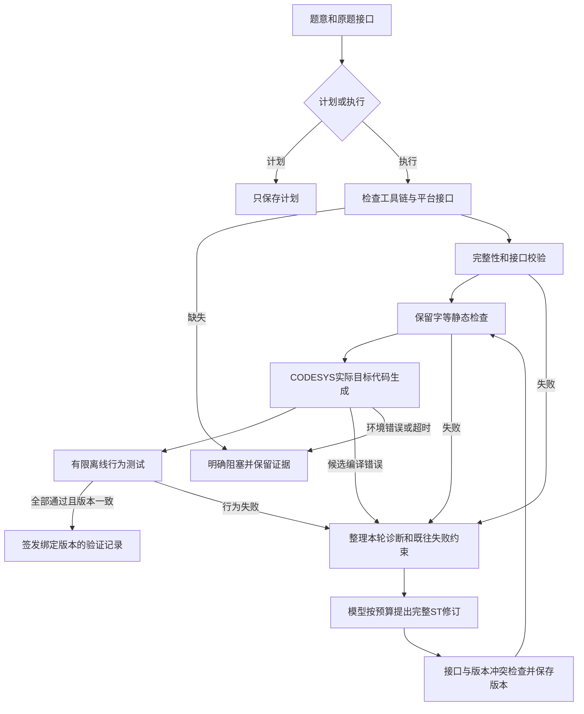

# R5 Agent 验证与修复流程优化

本轮将真实 CODESYS 编译纳入自研 Agent 的完成条件。用户本机已启用 `codesys` 验证模式；模型连接尚未配置，本轮没有调用外部模型。原始20份 R4 候选及18/20的 CODESYS 编译基线保持不变。

## 现在的执行流程



主控决定推进顺序。模型负责提出完整候选，不能靠自己的“已完成”陈述替代程序判定。需要新的生成或修复时仍需用户配置模型 API。

## 改进内容

| 改进 | 实现与效果 |
|---|---|
| 将验证配置与模型配置分开 | `validation.py` 读取本地 `agent_data/validation.json`。更换模型或在TUI保存模型参数不会关闭CODESYS验证；模型的项目文件写入工具也不能修改这个目录。 |
| 同一套完成条件 | `/solve`、自然语言调用的 `plc_solve_bank` 和 `plc_bank_test` 都使用配置中的验证目标。CODESYS模式要求静态检查、真实编译、有限行为测试同时通过。 |
| 生成前检查平台条件 | 工具链缺失、已知必需接口不可用时停止，保留原因，不启动无效的模型修复循环。当前目标的 `VARIANT` 被显式列为需适配的接口。 |
| 提前检查保留字 | 按不区分大小写的ST关键词检查变量声明。识别第20题的 `lint`，忽略注释和字符串中的同名文字，并提供行号及修复建议。 |
| 分层诊断 | 区分静态错误、CODESYS编译错误、行为反例、平台阻塞及基础设施异常。给模型紧凑的主要诊断，完整执行证据独立保存。 |
| 减少无效重试 | 保留已失败候选身份；连续两次重复失败源码后返回 `no_progress`。格式重试、内部修复与外部工具循环继续共享模型调用预算。 |
| 可失效的编译缓存 | 以题号、完整源码SHA和验证环境指纹查找。源文件、CODESYS文件/库、验证代码或配置变化后旧编译缓存失效；支撑证据丢失时重新编译。行为测试每次重新执行。 |
| 严格验证记录 | 通过记录绑定源码、R4后端、行为判据和CODESYS验证配置。缺少任一通过阶段、来源SHA不一致或配置改变，都不能作为当前通过证据。 |

静态检查只识别已经声明的规则，不能覆盖全部 CODESYS 语言错误；实际编译仍是必须执行的阶段。功能测试继续使用既有冻结判据，未修改判据来提高通过率。

## 本机使用

```powershell
# 查看完成条件和工具配置，不发模型请求
.\scripts\run.ps1 -m plc_agent.validation status

# 新电脑配置真实目标；本机已经执行过此步骤
.\scripts\run.ps1 -m plc_agent.validation configure --mode codesys --executable 'D:\大三上\GenAI赋能工业编程\codesys\CODESYS\Common\CODESYS.exe'

# 仅检查已有候选，不需要模型 API
.\scripts\run.ps1 -m plc_agent.validation check 20 experiments/backend_r4/tasks/20/final.st

# 重放结构集成自检，使用脚本回复和真实编译器
.\scripts\run.ps1 -m plc_agent.optimization_selftest
```

TUI中的 `/backend` 显示当前验证模式、目标平台和必需阶段。原来的计划模式边界、版本记录、会话、上下文压缩及预算保护保留。平台配置为本机文件，分享仓库时不附带 `agent_data/`。

## 验证结果与边界

机制自检记录在 `reports/agent_optimization/20261027_r5_selftest/`：

- 第20题测试副本：规则发现原 `lint` 命名；脚本回复只改为 `clampedWeight`；真实CODESYS目标编译和真实离线行为测试均通过。
- 第03题测试副本：人为插入不存在的函数，真实CODESYS编译失败；脚本回复恢复原功能，随后编译与行为测试均通过；请求包确实包含实际编译诊断。
- 第18题：因当前目标的必需接口未适配而返回 `platform_blocked`，没有请求任何修复回复。
- 同一候选再次验证：复用有效编译证据，行为检查仍重跑，没有请求修复回复。

上述“脚本回复”是确定的测试夹具，不是LLM生成结果。它们证明控制流程和反馈传输能够执行，不证明优化后真实模型的成功率已提高。正式能力比较仍需配置两个模型，用相同数据、预算和判据运行优化前后及基线框架实验。

这些通过结果表示真实 CODESYS **编译**加有限离线**行为**检查通过；尚未在 CODESYS 运行时或实体PLC上执行候选，也没有进行形式化验证。
