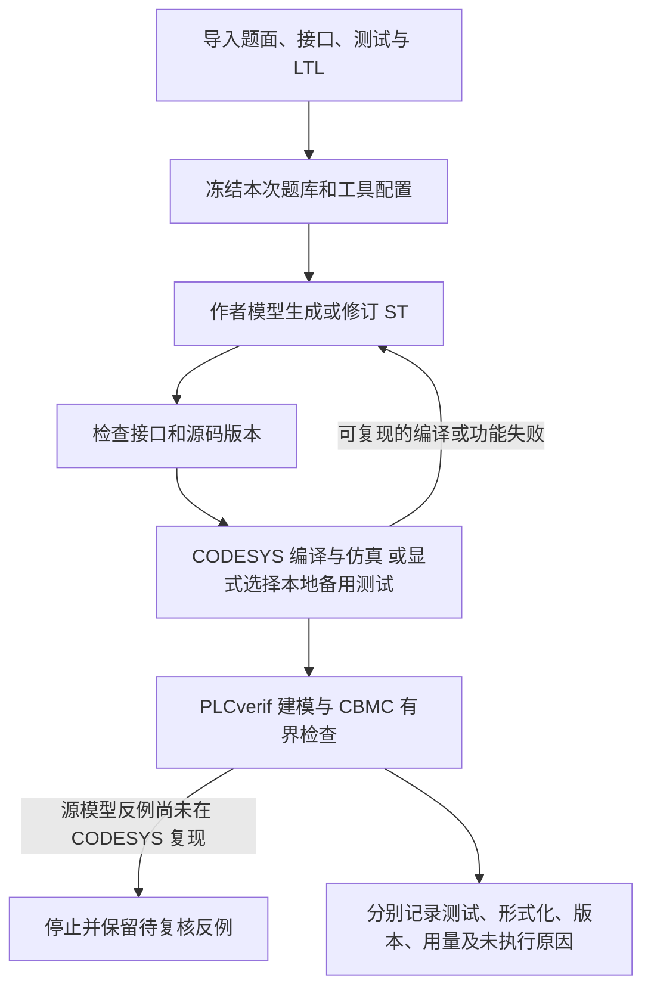

# 2026-11-03：现状、设计与整合结果

这次从 `agent-codesys-cbmc@0cdaaaef` 继续，保留队友的提交历史。该版本已包含 `bank32-v6` 和 `fix-formal-verification`，无需再重复合并这两个分支。整合修改发布在 `integration-20261103`；没有覆盖旧 main。

## 现在的 Agent 怎样工作

- **模型负责提出程序，工具负责给检查证据。** 作者初始输入没有测试预期表；修复收到实际失败。预算限制为每题最多 6 份源码、24 次模型请求、1800 秒。
- **厂商链与本地备用链有不同语义。** 公共 18 的本地 PV1/VARIANT 接口不能直接当作 CODESYS 原生接口；形式化中的有限类型/容量实例也不代表所有 PLC 类型都已建模。
- **形式化是有界结论。** 扫描上界、输入假设、内部循环展开、值域及工具状态随记录保存；未配置、超时、未支持不计为通过。
- **两框架对照共用同一检查器。** 网页有 self/Codex × 模型 A/B 的入口；本次没有运行完整 128 任务实验，也没有凭接口代码声称它已通过。
- **独立对抗审查、计划模式和模型总结式上下文压缩仍在历史终端流程。** 当前网页的题库循环是独立功能入口，并没有接通这些终端交互。网页单题与批量均明确使用 `review=False`。直接打开审查开关会遇到审查重放默认调用本地后端的问题，因此本次没有伪装成已整合。后续需让审查共用所选厂商后端、保留独立上下文与需求争议记录，再接入网页。

代码入口见 [代码导读](CODE_GUIDE.md)。历史终端用 `python -m plc_agent.legacy`，日常网页用 `start.cmd`。

## 本次具体修复

1. 恢复可填写的 Base URL、API Key 和准确模型 ID。单题和批量不再强制 DMXAPI；本地免鉴权兼容服务允许留空 Key。切换服务清除旧密钥，留在同一地址可保留密钥；API 不回传完整密钥。
2. 保存模型配置时保留超时、上下文/输出限制和高级请求参数；单题或批量运行中均禁止修改模型配置，避免运行中途换服务。
3. 补回目录整理时漏掉的历史 ST/contract 夹具，并修复 CODESYS 批量读取的旧测试替身、迁移后的终端入口及导入。历史候选明确标为回归输入。
4. 增加 `scripts/check_saved_candidates.py`，不用模型就能重编译、两次重放全部 32 份保存候选，保存源码/题库散列、计数与独立状态。
5. 提供当前目录布局的分发脚本，支持 SHA256 校验后的离线 Python wheels；排除本机密钥、运行环境与私人实验输出。
6. 服务未报告费用时记录 `cost=null`、`cost_complete=false`，避免把“未知”写成免费；Token 用量独立统计。

## 本机实际检查

| 检查 | 结果 | 结论范围 |
|---|---|---|
| 完整开发回归 | 294 项，293 通过，1 跳过 | 包含测试替身的代码回归；不是 294 项厂商实测 |
| 保存候选重放 | 32/32，每份两次结果一致 | 每遍 348 场景、5703 扫描、24111 断言；本地 R4 备用后端 |
| 真实 HTTP 单题流程 | CUSTOM_09，DeepSeek-flash，1 次请求 | 从空文件生成，25/25 场景通过；4287 Token，约 21.3 秒 |
| 该单题的 CODESYS / LTL | 未执行 / not_configured | 没有冒充厂商或形式化通过；未执行独立模型审查 |
| 配置页交互 | 实际浏览器检查自定义地址、状态及记录显示 | 模型密钥没有进入浏览器响应 |

保存候选源自 R8，经过之前的适应性修复。本次 32/32 不能用作新模型首次生成准确率；现有测试通过也不会自动解决旧的需求解释争议。实际 HTTP 运行的原始回执生成于费用修复之前，其未知费用曾写成 0；审计根据原始 usage 重新汇总为未知，原始证据保留。

机器可读摘要：[audit.json](validation/20261103/audit.json)；逐题源码/题库散列及重放统计：[saved_replay.json](validation/20261103/saved_replay.json)。本机原始输出保留在 `outputs/single/`，不公开私有完整会话。

## 队友怎样复现

1. 解压分享包，双击 `start.cmd`。包内 Python wheels 可离线安装，仍需已安装 Python 3.10+。源码克隆首次安装需联网。
2. 网页“模型与环境”填写自己的兼容服务；导入 `datasets/course32.json`。
3. 有 CODESYS 的电脑配置 exe、Profile 和专用空白仿真模板，通过正/负编译对照。无 CODESYS 时明确取消厂商选项，并配置本地备用后端。
4. 在已配置本地备用后端的环境执行 `python scripts/check_saved_candidates.py`，不产生模型请求；可用 `--ids CUSTOM_09` 缩小范围。
5. 开发回归：`python -m unittest discover -s tests -v`。历史夹具随源码提供，外部编译工具仍需安装。
6. 打包：`python scripts/package_team.py --output <新的zip路径> --wheels <已下载的wheels目录>`。已有输出拒绝覆盖；包中含逐文件 SHA256 清单。

## 下一步的优先顺序

先在具备 CODESYS + PLCverif + CBMC 的电脑跑同一份快照，取得正确程序通过、故意错误程序失败、反例能重放的证据，再扩大实验。然后把计划预览、独立对抗审查及模型总结式上下文压缩接到网页的统一运行状态上。这比继续增加未经实测的工具入口更有价值。当前电脑只有 Java 17，尚未配置匹配的 PLCverif；不存在 CODESYS、PLCverif、CBMC 的本机实测结论。
