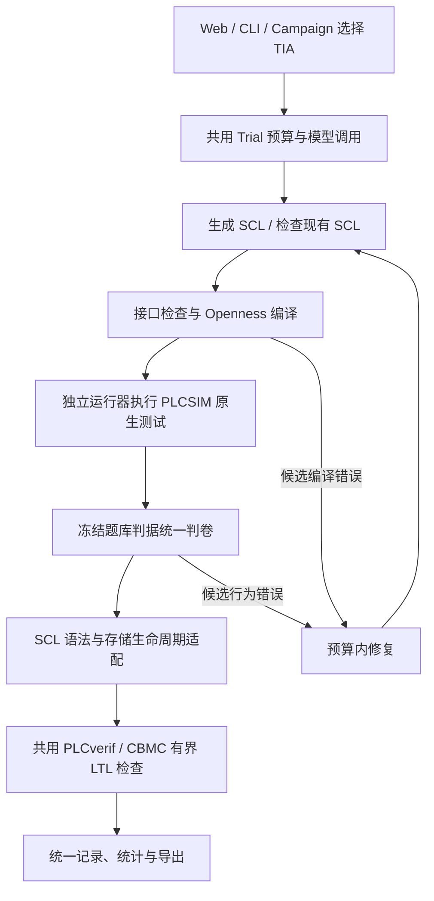

# TIA 配置、流程与复现

TIA Portal / Siemens SCL 已接入工作台单题、CLI 和 self/Codex × 模型 A/B 批量实验。本文说明当前使用方式与适配边界；验收结论集中在最终报告。共享验证核心沿用 integration-20261103 基线。

## 整体流程



## 共用与替换的边界

| 共用部分 | TIA 替换部分 |
| --- | --- |
| 题库、需求、接口和测试判据 | SCL 作者提示、固定接口检查 |
| Trial：6 个版本、24 次请求、1800 秒预算、请求计量 | `.scl` 文件与 TIA 评估入口 |
| self / Codex、两个模型、批量并发、暂停/恢复/停止 | 平台选择及 TIA 环境检查 |
| 测试序列和 `dataset.judge_output` | Openness 编译、PLCSIM Advanced 仿真执行 |
| `dataset_formal.attach`、PLCverif、CBMC、LTL 结果处理 | SCL 语法正规化回调，随后调用原共享验证器 |
| 日志、历史、版本、CSV、统计与最终代码导出 | 平台字段与 `.scl` 下载 |

TIA 的单题入口、CLI 完整检查及 2×2 批量实验均使用现有 Trial/Campaign。CODESYS 的现有入口及默认行为保留。模型请求可以并行，单机 TIA 调用串行排队，防止同时启动大量 Portal 会话。

完整流程为：生成源码 → 厂商编译 → 原生测试 → 共用判卷 → 共用形式化入口 → 结果记录/预算内修复。编译与行为阶段未通过时，形式化不执行，与 CODESYS 相同。遇到共享后端不支持、超时或待复核反例时，保留它的结论，不另外造一个 TIA 验证模型让其通过。

`tia_formal.py` 仅处理 SCL 边界：块名与局部变量写法、头部元数据、定时器实例调用写法、移位函数命名参数，以及 Siemens 临时变量的调用生命周期。开放数组边界查询的 `ARR := a, DIM := UDINT#1` 转为共享前端的 `a, 1`，不改变数组上下界；动态或非一维查询明确拒绝。POU 起始 `BEGIN` 在临时变量初始化建模后移除，避免进入引用调用展开体。它不提供 SHL/SHR 或 TON 的函数实现，不修改共享验证上界、求解策略、输入域或 LTL 判据。类型与指令是否支持最终由共享后端决定。

多场景开放数组默认逐个完整场景编译和执行，避免将所有形状展开到一个超过 CPU 代码容量的驱动中。每个场景原本就使用独立实例及调用方存储；批次不截短输入，不拆分单个状态轨迹。全部原生行按原顺序汇总后，只调用一次冻结的全题判据。各批次共用原仿真总时间预算和绝对截止时间；源码、运行器或输出协议变化、缺少任一批次均不能计为通过。`simulation/batch_manifest.json` 记录形状、行偏移、输入场景散列及各批次证据。基线对照的参数与命令见下文“复现最终验收”。

## 本机配置与使用

当前验收使用 TIA Portal / Openness V21、PLCSIM Advanced V8、CPU 1511-1 PN / V2.9 专用仿真模板。S7-1200 模板用于候选源码编译。模板关闭并保存，输出放在模板目录外。安装目录、项目路径与许可证属于本机配置。

1. 构建 `integrations/tia_bridge/TiaBridge.csproj`，使用本机 Openness V21 的 `net48` API 目录。构建会同时生成独立的 `TiaRuntime.exe`，部署时与 Bridge 放在同一目录；仅编译不需要启动该运行器。
2. 在“模型与环境”填写 Bridge、编译模板及可选 Openness 目录。
3. 原生仿真还需要已授权的 PLCSIM Advanced x64 API DLL，以及专用 S7-1500 `.ap21` 仿真模板。当前 S7-1200 模板仅用于编译。新 EXE 的 Openness 访问确认由使用者手动处理。
4. 形式化工具继续使用共用的 `formal_config.json`。本机已解压的 PLCverif/Java/CBMC 位于忽略目录 `.runtime`，不随代码提交。

Bridge 默认创建无界面 TIA 会话，结束时通过 Dispose 关闭自身创建的 Portal。需要交互演示或诊断时，可设置 `TIA_BRIDGE_WITH_UI=1`；图形模式断开连接后会保留界面，使用者需关闭已完成的会话。

原生执行分为两个进程：`TiaBridge.exe` 完成工程编译与虚拟卡导出并关闭 TIA，随后启动不引用 `Siemens.Engineering` 的 `TiaRuntime.exe`，由它负责 PLCSIM 注册、上电、执行、采样与清理。`prepared_card.json` 绑定源码、组合测试驱动、Bridge、运行器及虚拟卡文件哈希；运行器拒绝不匹配的交接，Python 在结束时再次检查运行环境是否变化。取消和清理仅作用于本次创建的进程及实例。

原生实例按仿真模板 CPU 的实际订货号注册，上电最多等待 180 秒。试用许可剩余天数提示需确认；可手动点击 OK，或按 [试用通知监听器](#可选试用通知监听器) 单独启动有时间和次数限制的监听器。这与 Openness 访问授权不同。上电前、成功后及失败时的状态、许可、CPU 类型和耗时记录在 `simulator_runtime.json`，不会把启动超时当作候选逻辑错误交给模型修复。原生执行仍需保留启动、工程准备及测试的总时间预算。

```powershell
# 现有 SCL，使用相同阶段门禁检查；不调用模型
python -m plc_agent tia check PUBLIC_02 path/to/candidate.scl --output outputs/tia_check

# 通过共用 Trial 生成、检查与修复
python -m plc_agent tia run PUBLIC_02

# 仅执行编译流程
python -m plc_agent tia run PUBLIC_02 --compile-only
```

工作台单题选择 TIA；批量实验也可选择 TIA，复用原有 self/Codex × 模型 A/B 的四组实验。平台配置未齐全时预检查阻止付费批量生成。


## SCL 语义适配边界

- 入口 FB 的固定临时数组、内嵌 STRUCT 和源码内 UDT，按实际成员展开成每次调用独立的新鲜标量值。保留原始源码和数组边界，不假设临时变量自动清零或跨扫描保留；单次最多展开 256 个标量成员。
- 同一源码内的辅助 FC/FB 可以包含临时变量，但必须能检查出在直线执行前缀内、任何读取前完成所有成员初始化。无法确认的分支初始化、未初始化读、初始化表达式及引用类型继续拒绝；不会用每扫描一个输入冒充每次辅助调用的新鲜值。
- 支持简单标识符形式的带引号局部名、成员名，以及嵌套移位调用的命名参数；保留字符串、注释和类型化字面量。规范化数组范围的词法空白，避免旧 STEP7 词法器把相邻范围点识别为实数。
- 支持同一 SCL 文件中完整声明、仅用于直接表达式读取的标量常量数据块。只接受字面量初值；在模型副本中内联对应常量，并记录“闭合程序、无外部写入”的平台假设。原生执行仍使用原始 DB。缺少定义、可变 DB、引用/输出绑定、调用参数中的潜在别名以及异步外部写入不在支持范围内。

这些是有条件的源模型适配，不是任意 TIA 程序与模型语义等价的证明。支持集合之外继续返回具体的未支持原因，不修改题库接口或削弱性质。

### 运行协调与诊断

- 使用当前 Windows 用户临时目录中的 OS 字节锁，在网页、CLI 和不同 checkout 进程间串行化 TIA 调用。等待可取消；进程退出会释放锁，不清理其他用户的 TIA/PLCSIM 会话。
- Bridge 保存 `bridge_progress.json`，分别标出 Portal 初始化、工程打开、生成块、编译硬件/测试驱动、导出卡和运行器启动阶段。
- 独立运行器回传具体失败阶段。Python 区分 Openness 访问初始化、PLCSIM 上电超时和其他阶段超时，保存原始消息及恢复建议；均不驱动模型修改源码，也不自动无限重试。
- PowerOn 超时不能直接归因于未确认许可提示。若没有看到提示，应保留实际状态、许可和阶段记录继续诊断；不自动操作权限或许可对话框。

跨进程协调限制资源争抢，阶段记录用于定位运行条件。

### 适配夹具复现

测试源码为 `examples/tia/AdapterBoundary.scl`，是为适配验收人工编写的独立夹具，不属于课程题库，也不是模型生成结果。它同时包含固定临时数组、带数组成员的 UDT、初始化后读取的辅助函数临时变量，以及只读外部 DB。X 为 SINT，Y 为 DINT，避免以输入域假设掩盖溢出。

```powershell
# 真实 PLCverif/CBMC 正负对照，不请求模型，不需要 API Key
python scripts/check_tia_adapter.py --output outputs/tia_adapter_new

# 加上真实 TIA 编译与 PLCSIM 执行；必须使用新的输出目录
python scripts/check_tia_adapter.py --native --output outputs/tia_adapter_native_new
```

默认上界为 3 次扫描。正例应返回 `bounded_pass`，将加数从 7 改为 8 的负例应检出 `counterexample`。原生正例应通过 6 行输出判据，原生负例应被行为测试检出并阻止后续形式化。

在当前共享结构化 C 导出路径中，适配夹具的负下界数组明确返回未支持，避免接受不正确的存储模型。适配器保留实际数组边界。

当前仍不宣称所有复杂临时变量、外部存储、全部 32 题或所有启动条件都已支持。

## 可选试用通知监听器

`integrations/tia_trial_ack` 是独立 Windows UI Automation 监听器。由命令行启动后，识别符合条件的试用剩余天数通知，并通过该按钮的 InvokePattern 执行 OK。它不需要坐标或全局回车。

### 运行

在仓库根目录的 PowerShell 执行一次，随后正常启动工作台检查任务：

```powershell
.\scripts\start_tia_trial_ack.ps1 -Acknowledge
```

默认后台运行 30 分钟，最多确认 10 个匹配通知，结束后退出。脚本返回 PID、输出及错误日志路径。日志保存在 `outputs/trial_ack`。不传 `-Acknowledge` 时仅观察，不点击。

```powershell
.\scripts\start_tia_trial_ack.ps1 -Acknowledge -TimeoutSeconds 7200 -MaxClicks 50
```

上例监听 2 小时，最多确认 50 次。直接以前台命令行运行也可：

```powershell
.\integrations\tia_trial_ack\bin\Release\net48\TiaTrialAck.exe --ack-trial-notice --timeout-seconds 1800 --max-clicks 10
```

### 匹配条件与边界

- 窗口标题包含 PLCSIM，所属进程位于 Program Files 中的 Siemens 安装目录，且文件公司信息包含 Siemens。
- 通知文字同时包含试用许可、到期/剩余提示及具体天数。
- 只有一个可用、可见的 OK/确定按钮，并能获取 InvokePattern。
- 激活、Skip、允许访问、密码和 Openness 等其他窗口不处理；试用期不会被延长，许可证不会被修改。
- 需要解锁的交互式 Windows 桌面；工具与目标窗口的权限等级需要兼容。无法读取或调用按钮时保留窗口，不改用盲目回车。

该工具是可选辅助程序，没有接入默认 Trial/Campaign。

## 复现最终验收

本轮基线固定为 `ea42b6ebcd41228d7c3e41ee526a9aafa9550751`。只验收基线已经具备且能由真实工具复现的能力，不扩展或重写共享形式化模型。题库、判据、PLCverif/CBMC、引用模型和观察器保持基线原样。

`scripts/check_tia_baseline.py` 读取固定 Git 提交中的参考源码，生成对应 SCL，并在两端调用相同共享模型。每对使用相同的任务快照、原公式、输入假设、类型/尺寸、扫描周期、扫描上界、展开上限、时间和内存限制。源文件、转换后的模型、配置及逐性质状态分别保存。

- 引用/别名/RETURN：来自基线 `scripts/check_plcverif_references.py`，bound=3、unwind=8、timeout=45s。
- PUBLIC_08：来自基线 `examples/formal/Q08.st` 和 `scripts/check_course_references.py`，4 种数组形状，boundary 数值域、bound=3、unwind=16、timeout=180s。保留正确程序、原始数组写坏、配置字段写坏三例。
- PUBLIC_18：来自相同基线的 Q18/PV1 回归，4 种载荷类型 × 容量 1/2/7，bound=4、unwind=16、timeout=180s。这是本地 PV1 存储契约的源模型检查，不是 TIA 原生 VARIANT ABI 验收。
- SHL：复用基线测试中 `SHL(DWORD#1, bitIndex)`、计数 0..31 的受限模式，加上可观察的位校验输出及负例；bound=3、unwind=256、timeout=120s。共享移位实现保持原样。

运行已由真实基线检查确认的 15 组对照：

```powershell
python scripts/check_tia_baseline.py --output outputs/tia_baseline_pairs_new --ids alias,alias_mutant,return,pv1,pv1_mutant,pv1_bounds,08_correct,08_raw_write,08_config_write,18_correct,18_count_only,18_missing_read,18_wrong_empty_status,shift,shift_mutant
```

独立检查其中有原生厂商接口的 SCL 是否能被实际 TIA 编译：

```powershell
python scripts/check_tia_baseline.py --output outputs/tia_baseline_compile_new --compile-only outputs/tia_baseline_pairs_new --ids alias,alias_mutant,return,08_correct,08_raw_write,08_config_write,shift,shift_mutant
```

复测不调用作者模型；每次使用新的输出目录。`AdapterBoundary.scl` 为人工验收夹具，不计入模型生成成绩。基线对照默认执行已验收的 15 组；额外继承模型探测须显式使用 `--include-probes`。

重放保存的课程 SCL：

```powershell
python scripts/check_tia_complex.py --output outputs/tia_replay_new
```

复杂题重放中的 PUBLIC_18 仅作原生 VARIANT 能力探测，不计为已通过的原生行为。模型生成、历史候选重放与人工参考源码的结果分别解释。

## 最终结果入口

[最终验收报告](../reports/tia_final_20261104/README.md)统一展示原生行为、15 组形式化对照、编译及自动回归结论，保留最终源码、必要输出和散列清单。运行过程写入忽略的 `outputs/`。

共享 PLCverif/CBMC、LTL、引用模型、观察器及判据保持基线原样。所有结论限定于报告列明的类型、输入域与有限扫描范围，PV1 源模型不代表厂商原生 VARIANT ABI，也不宣称全部 32 题、厂商全语义或实体 PLC 验证。
