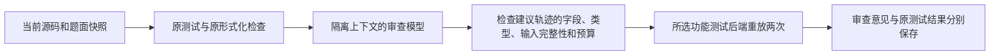

# 网页独立对抗审查（2026-11-04）

## 当前进度和本次边界

以昨天的 `integration-20261103@ea42b6e` 为父提交，在独立分支 `feature-web-review-20261104` 开发。本次检查时：

- CODESYS/CBMC 分支仍为 `0cdaaae`，昨天的 PR #3 待合并。
- 队友的 PR #4 今天合入他们的 `feat/tia-agent-integration`，该分支头为 `576fa212`；包含 TIA 原生测试、形式化适配及其报告。本次只核对远端文件与提交信息，没有在本机重做 TIA 实测。
- 本次不重复合并 TIA。审查核心通过传入 evaluator 对接后端，后续合并时可由 TIA 链路提供自己的重放器。

## 怎样使用

1. 启动网页，导入题库，选择题目并生成或粘贴 ST。
2. 选择实际可用的测试后端；CODESYS 使用已保存的专用仿真配置，取消厂商选项则显式使用本地备用后端。
3. 可在“审查模型 ID”填写同一服务上的另一个模型。留空时使用配置的 review_model 或当前模型。使用同一模型仍会建立独立请求上下文。
4. 点击“对抗审查（消耗 Token）”。先保存源码和题库快照，执行原有检查，然后调用审查模型。
5. 查看“独立对抗审查”：需求依据、待澄清项、源码 SHA256、短轨迹的重放次数，以及第一个期望/实际差异。完整轨迹和两次结果在 `details/review/` 与详细回执中。
6. 修改编辑器或切换源码版本后，页面提示当前编辑内容尚未检查；旧证据留在实验记录中。

## 流程与可信边界

审查模型没有作者历史、正式测试预期表、先前失败反馈、工具权限或写文件权限。它仅接收需求、附加约束、接口和当前源码。建议必须带需求依据，并限制为最多3个场景、每场景8次扫描、60秒逻辑时间。每个场景使用新的 FB 实例，首行时间0，输入完整、数值类型合法；不执行模型输出的任意表达式。

建议预期始终标为 `advisory_model_claim_only`。两次重放只能确认程序行为与这份建议预期是否一致，不能自动把模型期望升级为正确答案。程序、题库、正式预期表均不因审查而修改；不会将未经确认的建议送回作者自动修复。

状态含义：

| 状态 | 含义 |
|---|---|
| review_no_findings | 未发现新的可重放问题；不是正确性证明 |
| review_questions | 模型提出需求疑问，保持待澄清 |
| review_disagreement | 两次执行均与建议预期不一致，须核对引用的需求 |
| review_non_deterministic | 两次语义观测不一致 |
| review_model_error | 模型连接或限流失败；原测试结果继续保留 |
| review_tool_error | 重放失败，不能算程序缺陷 |
| review_invalid | 建议不合法，或源码/后端证据不匹配 |
| review_unsupported | 目前没有匹配的接口重放适配器 |

当前支持标量与固定数值/BOOL数组的 trace 题。结构、开放数组、VARIANT 与 IN_OUT 仍需专用审查适配器；不会用本地 ABI 静默代替 CODESYS。厂商路径明确调用 CODESYS 编译和仿真。本次机器仍缺厂商工具，相关路由和失败处理用测试替身验证；实际模型实测使用本地 R4。

新增建议轨迹只做功能重放，不借用原题 LTL 声称它们已经形式化证明。原题的有限测试和形式化结论保存在 final_evaluation；审查结论保存在 review。异机合并时保持这两个字段的独立含义。

## 实际模型检查

两次真实 HTTP 请求，模型均为 DeepSeek-flash：

- 正确候选：原25场景全部通过；模型提出3个场景、11次扫描、44项断言，重放两次均通过；另提出初始化疑问，保留为 review_questions。按题面“调用前初始值”和预扫描状态迁移规则，该疑问不构成已确认缺陷。
- 故意错误候选：仅把退出维护分支的 `State := 0` 改为 `State := 1`。模型找到维护结束后跳过等待的反例；第2次调用期望0、实际1，两次重放一致。原测试也能检出该错误（20/25通过），所以这里只验证流程，不声称新增覆盖或审查准确率。
- 请求共2次、6703 Token，服务未返回费用，因此 cost 为未知。CODESYS、完整LTL及TIA实测不在本次结果中。

证据见 [实测摘要](validation/20261104/live_summary.json)、[正确候选审查](validation/20261104/correct_review.json)、[故意错误候选审查](validation/20261104/mutant_review.json)。报告不包含 API Key、完整私人会话或本机工具路径。

回归命令：`python -m unittest tests.test_adversarial_review tests.test_web -v`。完整回归305项（304通过、1跳过），最终审查/HTTP专项24项全部通过；机器可读汇总见 [checks.json](validation/20261104/checks.json)。没有改变四组实验的默认协议；批量审查、网页计划与长对话总结压缩仍待单独接入。

## 后续合并接口

`adversarial_review.run(task, source, directory, provider, evaluator, backend=...)` 不依赖 web 或 Trial。evaluator 必须返回当前源文件的 source_sha256、匹配的 test_backend，以及包含实际 cases 的功能结果。TIA 路径可传自己的执行器，不能复用 CODESYS 通过标志。源码版本或冻结题目发生变化时，本次审查停止，已保存的结果不得沿用。
