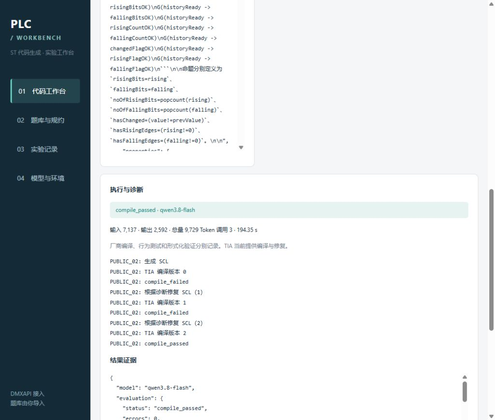

# Python Agent → TIA Portal 阶段三实测与第 8 项验收

日期：2026-11-01。分支：`feat/tia-agent-integration`（基于 `bank32-v6`）。

**第 8 项已完成：覆盖 3 道不同 PLC 题，共 4 组真实模型端到端运行。** 每组均读取冻结题库，从空白开始调用模型生成完整 Siemens SCL，经过固定接口检查，再由 Python 调用第二阶段 C# Bridge，在独立工程副本中完成 TIA Portal V21 导入、生成块与编译。PUBLIC_02 的 Qwen 运行还真实经历了两次编译失败、两轮模型修复后通过。

全过程没有人工修改模型源码，没有注入故障，未改变题库接口或测试。

## 题目覆盖与实测结果

| 题目 | 覆盖内容 | 端到端记录 |
| --- | --- | --- |
| PUBLIC_01：Automated Filling Line Control | 灌装线顺序控制、静态状态、布尔接口 | 自动生成，首次 TIA 编译通过，0 错误、0 警告 |
| PUBLIC_02：Dual-Word Edge Detection | DWORD 位运算、跨扫描历史、计数 | DeepSeek 首次通过；Qwen 根据真实诊断修复两轮后通过 |
| CUSTOM_01：电梯方向保持与满载屏蔽目标调度 | ARRAY[1..6] 输入、循环、方向与满载筛选 | 自动生成，首次 TIA 编译通过，0 错误、0 警告 |

| 题目 | 模型 | 推理设置 | TIA 编译过程 | 模型调用 | 总 Token | 总耗时/秒 |
| --- | --- | --- | --- | ---: | ---: | ---: |
| PUBLIC_01 | deepseek-v4.1-flash-1017 | 服务默认 | 0 错误 / 0 警告 | 1 | 9002 | 110.409 |
| PUBLIC_02 | deepseek-v4.1-flash-1017 | 服务默认 | 0 错误 / 0 警告 | 1 | 7715 | 84.448 |
| PUBLIC_02 | qwen3.8-flash | 关闭思考 | 2 错误 / 0 警告 → 2 错误 / 2 警告 → 0 错误 / 2 警告 | 3 | 9729 | 194.35 |
| CUSTOM_01 | deepseek-v4.1-flash-1017 | 服务默认 | 0 错误 / 0 警告 | 1 | 6788 | 75.726 |

编译通过标准是 `ErrorCount == 0`。Qwen 最终仍有两条 “The sign or the accuracy of the value may be lost.” 类型转换警告；不能描述为零警告。

## 自动修复证据

Qwen 的 PUBLIC_02 初稿使用位置参数 `SHL(16#1, #i)`，TIA 报两处函数参数不匹配。第一轮模型修复为 `SHL(IN := 16#1, N := #i)`，TIA 再报两处 “No non-typed constants can be used at this location.”。第二轮模型将输入常量改为 `DWORD#16#1`，TIA 随后编译通过。每次修改均由模型根据上一轮实际诊断产生，宿主程序只写入完整 SCL 并再次调用 Bridge。

- [Qwen 初稿](qwen/version_00.scl)、[第一轮修复](qwen/version_01.scl)、[第二轮修复](qwen/version_02.scl)。
- [首次诊断](qwen/compile_00/result.json)、[第二次诊断](qwen/compile_01/result.json)、[最终编译结果](qwen/compile_02/result.json)。

## 新增两题的交付文件

- PUBLIC_01：[生成的完整 SCL](public01_deepseek/candidate.scl)、[TIA 编译结果](public01_deepseek/compile_00/result.json)、[端到端 receipt](public01_deepseek/receipt.json)。
- CUSTOM_01：[生成的完整 SCL](custom01_deepseek/candidate.scl)、[TIA 编译结果](custom01_deepseek/compile_00/result.json)、[端到端 receipt](custom01_deepseek/receipt.json)。
- PUBLIC_02 DeepSeek：[完整 SCL](deepseek/candidate.scl)、[编译结果](deepseek/compile_00/result.json)。
- [机器可读验收汇总](report.json)、[交付文件 SHA256 清单](files.sha256.json)。各模型子目录包含任务快照、作者输入、源码版本、实际写入的 input.scl、stdout/stderr 和 receipt。完整工程副本保留在原始运行目录。

## Workbench 中查看或复现

在“实验记录”中按题号及模型查看已完成运行，点击记录可查看代码、版本、编译诊断、Token 与耗时。原始记录位于 `agent_data/web_runs`：

- `PUBLIC_01` / `deepseek-v4.1-flash-1017`：`6941676a887445f89b717a1f2ac42e00`。
- `PUBLIC_02` / `deepseek-v4.1-flash-1017`：`f52219e4ea8e459c95f222d18409eadd`。
- `PUBLIC_02` / `qwen3.8-flash`：`ba93b605171547b68fe3e415ddbb9f74`。
- `CUSTOM_01` / `deepseek-v4.1-flash-1017`：`2961f1f53cb0445985864a13d09cda19`。

再次演示时导入对应题目，选择 TIA Portal / Siemens SCL 平台，清空源码后点击“生成并自动修复”。Qwen 本次成功记录使用关闭思考；首次编译通过的记录直接结束，存在编译错误时自动将诊断反馈给模型并重编译。

## 服务端失败与设置变化

最初使用简称 `dsv4.1-flash-1017` 时服务商返回 503 / `model_not_found`。读取当前模型目录后核实准确 ID 为 `deepseek-v4.1-flash-1017`，本机默认配置和网页候选已更正。Qwen 服务默认推理设置的首次代码请求在 180 秒后读取超时；随后短连接测试成功，使用项目已有 `enable_thinking=false` 控制重跑，得到上述完整编译与修复记录。两次失败单独记录于 report.json，未计入源码编译失败，也没有将其未知 Token 用量记作已知的零。

这些记录用于接入与修复流程演示；模型推理设置不同，不作为公平的模型能力对比实验。

## 验收边界

本轮证明了三道不同题的真实模型生成和厂商编译，以及其中一组完整的自动修复过程。未进行 PLC 下载、仿真、扫描行为测试或 LTL 证明，也不能由这三道题推导全部 32 题的通过率。各轮固定接口检查通过，原始数据集 SHA256 保持不变；模板主文件 SHA256 在所有编译前后保持一致。报告文件不含 API Key。

## 工作台展示

